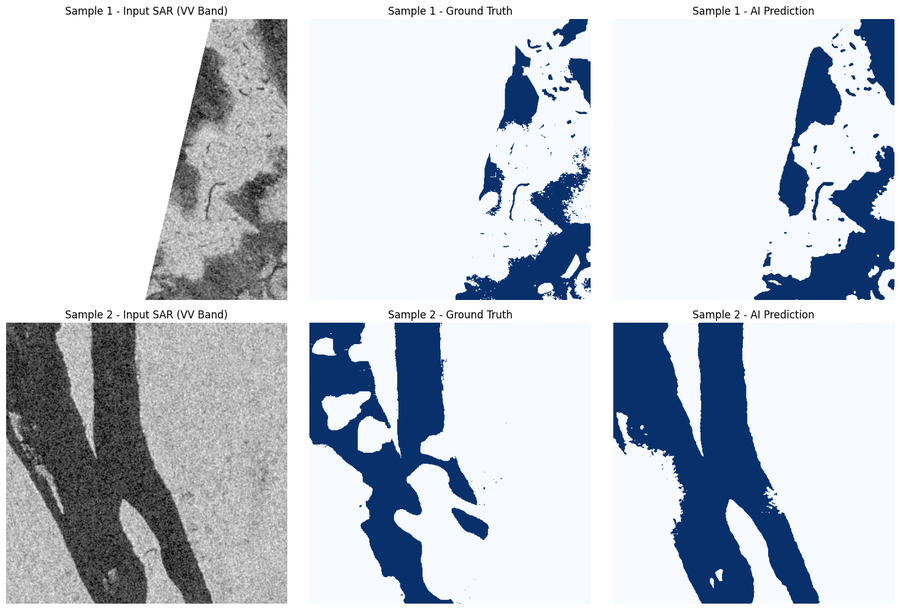
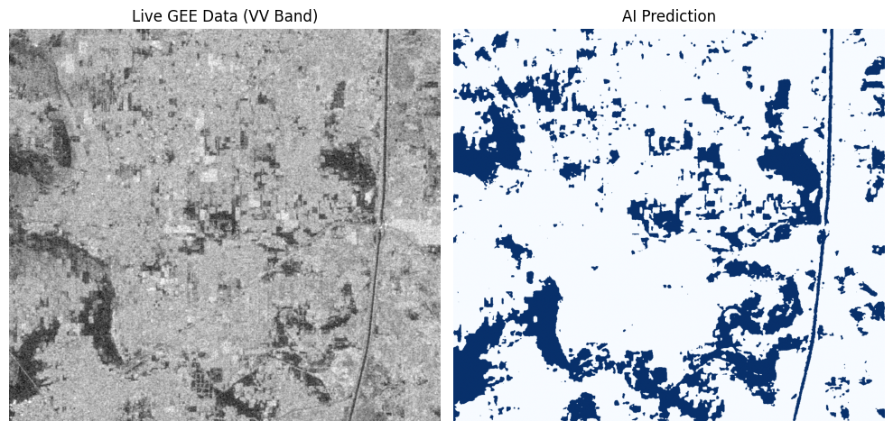

# SAR flood mapping

A college project: segmenting flood water in Sentinel-1 radar images with a U-Net (ResNet-34 encoder), then running the trained model on a fresh Earth Engine image.

Radar sees through cloud and darkness, which is when optical satellites fail during floods. The notebook trains on hand-labelled flood events from [Sen1Floods11](https://github.com/cloudtostreet/Sen1Floods11) and predicts a water mask from a new Sentinel-1 scene.



## Result

| | |
|---|---|
| Best validation IoU (water) | **0.66** (epoch 100 of 100) |
| Data | Sen1Floods11 hand-labelled Sentinel-1 tiles, VV and VH bands |
| Model | U-Net with a ResNet-34 encoder (`segmentation-models-pytorch`) |

The same validation set chose the saved checkpoint, so 0.66 is an optimistic estimate; there is no separate test set and no thresholding baseline in the notebook.

## How it works

1. **Data:** Sen1Floods11 radar tiles and masks, downloaded with `gsutil`.
2. **Input:** the VV and VH bands plus their average as a third channel, so a three-channel encoder can be used.
3. **Training:** Adam, a combined binary cross-entropy and Dice loss (water is a small share of most tiles), and flips, 90° rotations and grid distortion from Albumentations.
4. **Inference on a new scene:** a Sentinel-1 patch is exported from Google Earth Engine and predicted, with the output kept in EPSG:4326 coordinates.



## Files

- `Indus_flood.ipynb` — data download, training, evaluation and Earth Engine inference.
- `sar_flood_resnet34_best.pth` — the trained weights (about 93 MB).
- `clean_notebooks.py` — strips notebook metadata so GitHub renders it.

## Run it

Python 3 with a GPU is recommended. Earth Engine inference needs your own [Earth Engine](https://earthengine.google.com/) project.

```bash
pip install torch segmentation-models-pytorch albumentations rasterio earthengine-api geemap
```

Then open `Indus_flood.ipynb` and run the cells in order. To use the saved model without training, run only the visualisation or inference cells and point them at `sar_flood_resnet34_best.pth`.
